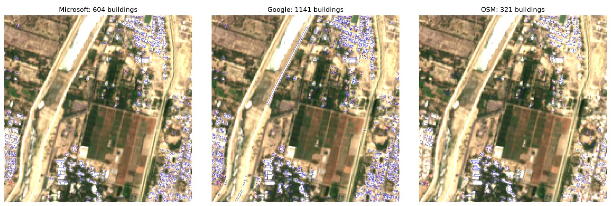
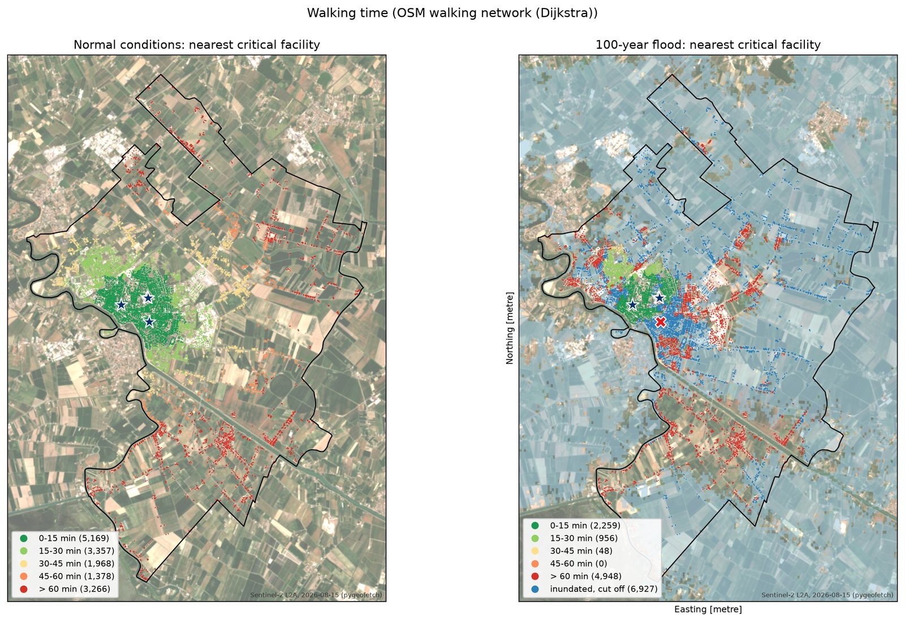

<div align="center">

# pygeovision

**From "I need imagery of this place" to a finished map, mask or dataset: search, preprocess, model and assess in one package.**

[](https://pypi.org/project/pygeovision/)
[](https://pypi.org/project/pygeovision/)
[](https://github.com/EOCoreINT/pygeovision/blob/main/LICENSE)
[](https://doi.org/10.5281/zenodo.22258220)
[](https://appiahkubis14.github.io/pygeofetch-docs/)
[](#end-to-end-pipelines)
[](#models-and-training)
[](https://appiahkubis14.github.io/pygeovision-docs/)

[Features](#features) · [Installation](#installation) · [Quick start](#quick-start) · [Case studies](#case-studies) · [Command line](#command-line) · [Pipelines](#end-to-end-pipelines) · [OBIA](#object-based-image-analysis-obia) · [Status](#project-status) · [Citation](#citation) · [Documentation](#documentation)

</div>

---

> **Status: actively developed.** The core workflow (search → download → preprocess → run a model → assess) is tested,
> but not every part is equally mature. See [Project status](#project-status) before you rely on a feature.

## Statement of need

Applying AI to satellite imagery is slowed down less by the models than by everything around them. A typical project
joins a provider-specific download library, a preprocessing script, a modelling framework and a pile of one-off code
for masks, tiling, reports and accuracy checks. Each join is a place where results quietly go wrong: a cloud pixel
treated as a class, a reprojection that shifts a mask, a model run on the wrong bands. Whole scenes of about a gigabyte
are downloaded to analyse a few square kilometres, and the steps are rarely scripted in a way that someone else can rerun.

Existing tools cover parts of this chain well: data access, deep-learning training, object-based analysis. Few cover
the whole path from "I need imagery of this place" to a documented, reproducible result, and fewer say plainly which
parts have been checked against real data. pygeovision is written for geospatial researchers who want satellite data and
AI in one import, ML practitioners who would rather not hand-roll provider APIs, and teams who need scriptable,
schedulable workflows.

## Objectives

1. **One interface to the data.** Search and download from 22 providers through
   [pygeofetch](https://doi.org/10.5281/zenodo.22087230), fetching only the study area when possible.
2. **Trustworthy preprocessing.** Cloud and nodata pixels are masked, never classified; inputs are validated before they
   reach a model.
3. **Models inside the package.** Segmentation, detection, change detection, classification and foundation-model
   embeddings, with training, losses and tiled inference for full scenes, and no separate AI-platform account.
4. **From bounding box to deliverable.** Pipelines that return maps, vector layers, statistics and a PDF/Word/Excel
   report in a single call or command.
5. **Object-based image analysis.** Segmentation, object features, classification and object-level accuracy, each checked
   against an independent reference.
6. **Honesty about maturity.** The documentation states what was tested on real data, what only on synthetic data, and
   what is deliberately unimplemented.

## Features

| Area | What you get |
|---|---|
| **Data** | 22 providers; resumable downloads with checksums; AOI-only streaming with fallback to a full download; chained post-processing; YAML pipelines with cron scheduling |
| **Preprocessing** | Cloud masking, band stacking, 21 spectral indices, AI-ready preparation, a data validator |
| **Models** | Segmentation, detection, change detection, CLIP zero-shot classification, foundation-model embeddings |
| **Pipelines** | 42 end-to-end workflows with reports and vector outputs |
| **OBIA** | Ten segmentation methods, object features, rule, fuzzy and supervised classification, object-level accuracy |
| **Labeling and explainability** | Labels from OpenStreetMap, building footprints, WorldCover and SAM; Grad-CAM, uncertainty, SHAP |
| **Monitoring and deployment** | Drift detection and alerting; ONNX Runtime, NVIDIA Jetson, AWS, Azure and GCP deployers |

## Installation

```bash
pip install pygeovision                # core: data search/download + band-math inference
pip install "pygeovision[geo]"         # rasterio, geopandas, ...
pip install "pygeovision[train]"       # PyTorch and training tools
pip install "pygeovision[obia]"        # scikit-image, scikit-learn (OBIA)
pip install "pygeovision[report]"      # PDF/Word/Excel reports for pipeline runs
pip install "pygeovision[all]"         # everything except cloud/edge
```

Python 3.10 or newer. PyTorch is only needed for training and deep-model inference. The full list of extras is in the
[documentation](#documentation).

## Quick start

```python
import pygeovision as pgv

client = pgv.PyGeoVision()

results = client.search(bbox=(38.6, 8.9, 38.95, 9.15),
                        date_range=("2024-01-01", "2024-04-30"),
                        cloud_cover_max=15)
scene = client.download(results[:1], output_dir="./data",
                        bands=["B02", "B03", "B04", "B08", "B11", "B12"])[0]

ready = client.prepare_for_ai(scene.path, model_type="foundation", output_path="./data/ready.tif")
client.classification.land_cover(ready["output_path"], output_path="./land_cover.tif")
```

## Case studies

Two complete analyses built on pygeovision, written for the course 856.114 GeoHumanitarian Action (University of
Salzburg, 2026). Both run in Google Colab with one click and need no Google Earth Engine account.

| | Piura, Peru: urban growth 2020–2025 | San Donà di Piave, Italy: health access in a 100-year flood |
|---|---|---|
| **Notebook** | [piura-urban-growth-pygeovision](https://github.com/appiahkubis14/piura-urban-growth-pygeovision) [](https://colab.research.google.com/github/appiahkubis14/piura-urban-growth-pygeovision/blob/main/piura_growth_pygeovision.ipynb) | [sandona-health-access-pygeovision](https://github.com/appiahkubis14/sandona-health-access-pygeovision) [](https://colab.research.google.com/github/appiahkubis14/sandona-health-access-pygeovision/blob/main/sandona_accessibility_pygeovision.ipynb) |



*Piura: building footprints from Microsoft (left), Google (centre) and OpenStreetMap (right). The same 2.76 km² box
holds 321 to 1,141 buildings depending on the source.*



*San Donà: walking time to the nearest critical health facility, normal conditions (left) and 100-year flood (right).
Buildings within 60 minutes of critical care fall from 78.4 % to 21.6 %.*

## Command line

Everything above is also available from the shell:

```bash
pygeovision data search --bbox -74.1 40.6 -73.7 40.9 --date 2024-06 --satellite sentinel-2
pygeovision data download --bbox -74.1 40.6 -73.7 40.9 --date 2024-06 --output ./data/
pygeovision channel list
pygeovision channel building_footprints --bbox -0.15 51.47 -0.10 51.52 --date 2024-06
pygeovision status    # what is installed and working
pygeovision doctor    # diagnose a broken setup
```

## End-to-end pipelines

42 pipelines run from Python (`client.pipeline(name, ...)`) and from the CLI (`pygeovision channel <name>`). 35 run out of
the box (flood, fire, snow, water, land cover, terrain, buildings, roads and more); 7 run a network you trained
yourself and refuse to start without `checkpoint=`. Every run also writes a deliverables folder with a map, vector
layers, statistics and a PDF/Word/Excel report (`pip install "pygeovision[report]"`). `pygeovision channel list` shows
each pipeline; the documentation describes them one by one.

```python
client.pipeline("wildfire_severity", bbox=bbox, output_dir="out", date_before="2018-10", date_after="2018-12")
```

## Models and training

Architectures are registered by name (`pygeovision models list`): SegFormer, Mask2Former, DETR, ChangeFormer, SAM, CLIP,
DINOv2, Prithvi, DOFA and a native hub including U-Net and DeepLabV3+. Training supports fine-tuning from a checkpoint,
geospatial losses, mixed precision, gradient accumulation and multi-GPU, and inference runs in Gaussian-blended tiles so a
model trained on small chips can process a full scene. The registry holds architectures, not trained weights.

## Object-based image analysis (OBIA)

Analyse imagery as objects instead of pixels: segment, describe, classify, assess.

```python
from pygeovision import obia

rd    = obia.fetch_scene(client, (-1.70, 6.18, -1.655, 6.225), "2024-01", "./download")  # Sentinel-2, cloud-masked
seg   = obia.segment(rd, "multires", scale=16)                                           # cloud pixels become label 0
feats = obia.extract_features(seg.labels, rd, extra_layers=obia.spectral_layers(rd))
rules = obia.RuleBasedClassifier([("water", "mean_ndwi > 0.3"), ("vegetation", "mean_ndvi > 0.5")], default="other")
result = rules.classify(feats)
```

Ten segmentation methods are available (`multires`, `spectral_difference`, `quadtree`, `multi_threshold`,
`contrast_split`, `slic`, `felzenszwalb`, `quickshift`, `watershed`, `chessboard`). `multires` follows the published
Baatz & Schäpe criterion and is not a clone of eCognition. See the
[OBIA guide](https://github.com/EOCoreINT/pygeovision/blob/main/docs/obia/index.md).

## Project status

- **Pipelines:** most were tested on synthetic rasters with known answers. `building_footprints`, `road_network`,
  `terrain_analysis`, `urban_expansion` and the Sentinel-2 readers have also run on real data in the case studies.
  Optical pipelines are limited by clouds, haze and shadow.
- **Deep-learning layer:** verified offline with synthetic data and tiny random models, never with pretrained weights, a
  GPU or real scenes. Treat first runs on your data as validation runs.
- **Your own weights:** seven pipelines and the `infer` commands run a network you trained; pygeovision ships no
  weights for them. Some features download model weights on first use.
- **Placeholders:** a few registry entries are deliberately unimplemented and raise `NotImplementedError`.

Details, removed features and the roadmap are in the
[documentation](https://appiahkubis14.github.io/pygeovision-docs/).

## Testing

```bash
pip install "pygeovision[dev,train,geo,obia]"
pytest tests/
```

## Documentation

Full documentation, with a guide for every pipeline, command and OBIA step:
**<https://appiahkubis14.github.io/pygeovision-docs/>**.

## Citation

If you use pygeovision in your work, please cite it:

> Appiah Kubi, S. (2026). *pygeovision: A Unified Open-Source Python Platform for Satellite Earth Observation AI*
> (Version 2.1.9) [Software]. Zenodo. https://doi.org/10.5281/zenodo.22258220

```bibtex
@software{appiah_kubi_2026_pygeovision,
  author    = {Appiah Kubi, Samuel},
  title     = {pygeovision: A Unified Open-Source Python Platform for Satellite Earth Observation AI},
  year      = {2026},
  version   = {2.1.9},
  publisher = {Zenodo},
  doi       = {10.5281/zenodo.22258220},
  url       = {https://doi.org/10.5281/zenodo.22258220}
}
```

Please also cite pygeofetch, the satellite data layer: Appiah Kubi, S. (2026). *pygeofetch: A Unified Python Framework
for Multi-Provider Satellite Data Acquisition, Pre-download Quality Control, and Geospatial Processing* (Version
v2.6.2.1) [Software]. Zenodo. https://doi.org/10.5281/zenodo.22087230

## Contributing and license

Contributions are welcome; see the
[contributing guide](https://github.com/EOCoreINT/pygeovision/blob/main/docs/project/contributing.md). pygeovision is
released under the [MIT License](https://github.com/EOCoreINT/pygeovision/blob/main/LICENSE).

The satellite data layer is built on [pygeofetch](https://appiahkubis14.github.io/pygeofetch-docs/). The case studies
use data from OpenStreetMap contributors (ODbL), Microsoft Global ML Building Footprints (ODbL), Google Open Buildings v3
(CC BY 4.0), GHSL R2023A (JRC), JRC / Copernicus GloFAS flood hazard maps, Copernicus Sentinel-2 and GLO-30 DEM (ESA),
and HeiGIT openrouteservice; their full credits are in the notebooks.