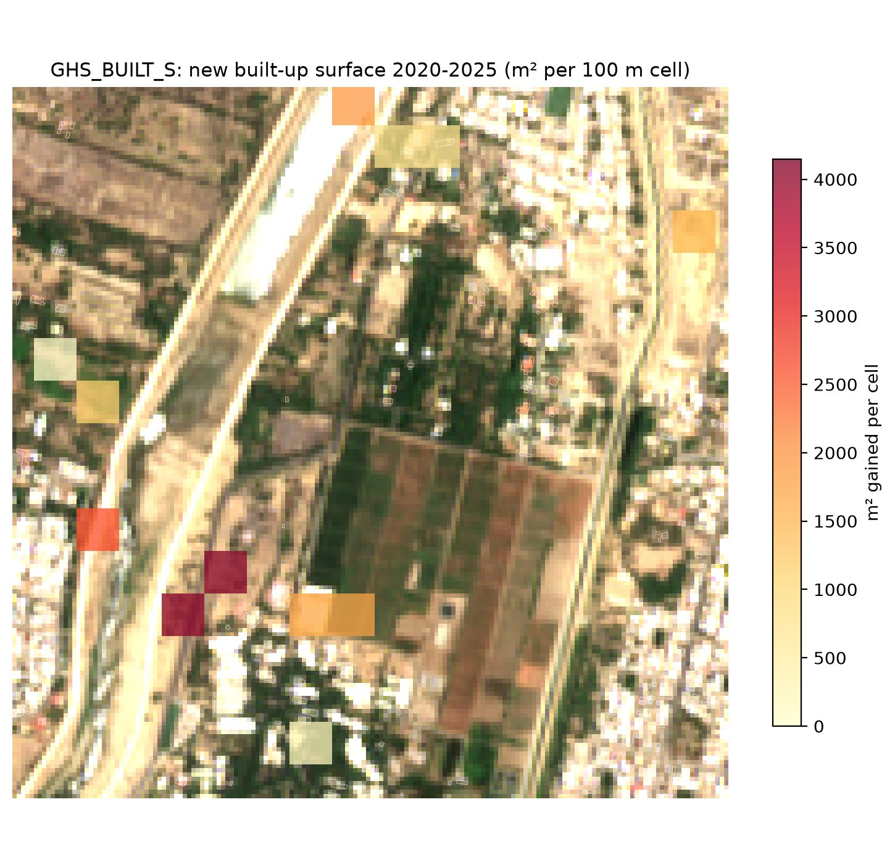
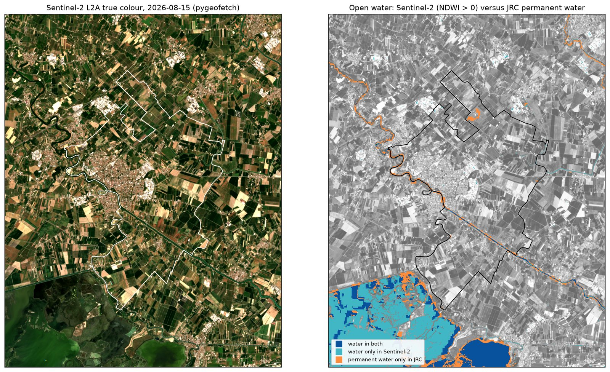

<div align="center">

# pygeovision

**From "I need imagery of this place" to a finished map, mask or dataset: search, preprocess, model and assess in one package.**

[](https://pypi.python.org/pypi/pygeovision)
[](https://pypi.python.org/pypi/pygeovision)
[](LICENSE)
[](https://doi.org/10.5281/zenodo.22258220)
[](https://appiahkubis14.github.io/pygeofetch-docs/)
[](#%EF%B8%8F-end-to-end-pipelines)
[](#-models-and-training)
[](https://appiahkubis14.github.io/pygeovision-docs/)

[Features](#-features) · [Install](#-installation) · [Quick start](#-quick-start) · [Case studies](#-case-studies) · [CLI](#%EF%B8%8F-command-line) · [Pipelines](#%EF%B8%8F-end-to-end-pipelines) · [OBIA](#-object-based-image-analysis-obia) · [Status](#-project-status) · [Citation](#-citation) · [Docs](#-documentation)

</div>

---

> **Status: actively developed.** The core workflow (search → download → preprocess → run a model →
> assess) is tested, but not everything is equally mature. [Project status](#-project-status) lists what
> is partial, optional or deliberately unimplemented, so you know before you rely on it.
> Two [case studies](#-case-studies) show the published-data pipelines at work on real places.

## Why pygeovision

Applying AI to satellite imagery usually means gluing together a data-download library, a preprocessing
pipeline, a modelling framework and a pile of custom code. pygeovision puts those steps behind one
package, so there are fewer joins in the chain for things to quietly break.

- **One search/download interface across 22 providers** (Sentinel, Landsat, Planet, Maxar, Copernicus,
  USGS and more) through [pygeofetch](https://doi.org/10.5281/zenodo.22087230), with credentials stored
  once in the system keyring.
- **Models that run inside the package**: segmentation, detection, change detection, classification and
  foundation-model embeddings, with no separate AI-platform account.
- **41 pipelines** from a bounding box to a finished output: 34 run out of the box, 7 run a model you trained.
- **A training stack** with fine-tuning, geospatial losses and tiled inference for full scenes.
- **Object-based image analysis**: segmentation, object features, rule/fuzzy/supervised classification
  and object-level accuracy.
- **A CLI and a Python API** that cover the same ground.

It is aimed at geospatial researchers who want satellite data and AI in one import, ML practitioners who
would rather not hand-roll provider APIs, and teams who need scriptable, schedulable workflows.

## ✨ Features

| Area | What you get |
|---|---|
| **Data** | Search and download from 22 providers; parallel, resumable downloads with checksum verification; chained post-processing (`unzip`, `reproject`, `compress`, `resample`, `clip`, `merge`, `ndvi`/`ndwi`, `pan-sharpen`, `atmospheric:sen2cor`, `cog`); YAML pipelines with cron scheduling |
| **Preprocessing** | Cloud masking, normalisation, band stacking and AI-ready preparation (`prepare_for_ai`); 21 spectral indices and transforms (NDVI, EVI, NBR, tasselled cap, PCA, …); a data validator that can repair common problems |
| **Segmentation** | Buildings, water (NDWI), SAM, or your own model |
| **Detection** | Generic objects, ships, cars (YOLO; needs the optional `ultralytics` package) |
| **Classification** | CLIP zero-shot scene classification; ESA WorldCover land cover |
| **Change detection** | Change vector analysis (Otsu) with no weights, or ChangeFormer / BIT / DSAMNet with your own trained checkpoint |
| **Foundation models** | Prithvi-EO, DINOv2, SAM, CLIP/RemoteCLIP, DOFA, TESSERA and AlphaEarth embeddings |
| **Labeling** | Generate training labels from OpenStreetMap, Microsoft and Google building footprints, ESA WorldCover, Dynamic World, SAM and foundation models |
| **OBIA** | Scale-controlled segmentation, object features, rule/fuzzy/supervised classification, object-level accuracy |
| **Explainability** | Grad-CAM / Grad-CAM++, uncertainty estimation, attention maps, SHAP |
| **Monitoring** | Drift detection, performance tracking and alerting for deployed models |
| **Deployment** | ONNX Runtime, NVIDIA Jetson, and AWS SageMaker / Azure ML / GCP Vertex AI deployers |

## 📦 Installation

```bash
pip install pygeovision                     # core: data search/download + band-math inference
pip install "pygeovision[geo]"              # rasterio, geopandas, rioxarray, ...
pip install "pygeovision[train]"            # PyTorch, timm, segmentation-models-pytorch, albumentations, ...
pip install "pygeovision[foundation]"       # transformers, scikit-learn, umap, faiss (foundation models)
pip install "pygeovision[obia]"             # scikit-image, scikit-learn, rasterio, geopandas (OBIA)
pip install "pygeovision[report]"           # map, vector layers and PDF/Word/Excel reports for every pipeline run
pip install "pygeovision[all]"              # everything except cloud/edge
```

Other extras: `vlm` (CLIP), `labeling`, `xai`, `monitoring`, `advanced`, `geo3d`, `viz`, `edge`
(ONNX Runtime), `cloud` (AWS/Azure/GCP SDKs), `dev` (tests and linters).

**Requirements:** Python 3.10+. PyTorch is only needed for training and deep-model inference; search,
download, NDWI/NDVI segmentation and the OBIA module work without it.

## ⚡ Quick start

Search, download, prepare and classify one scene:

```python
import pygeovision as pgv

client = pgv.PyGeoVision()

results = client.search(bbox=(38.6, 8.9, 38.95, 9.15),
                        date_range=("2024-01-01", "2024-04-30"),
                        cloud_cover_max=15)
scene = client.download(results[:1], output_dir="./data",
                        bands=["B02", "B03", "B04", "B08", "B11", "B12"])[0]

ready = client.prepare_for_ai(scene.path, model_type="foundation",
                              output_path="./data/ready.tif")
client.classification.land_cover(ready["output_path"], output_path="./land_cover.tif")
```

Segmentation, detection and change detection follow the same pattern:

```python
client.segmentation.buildings("scene.tif", output_path="buildings.tif")
client.detection.ships("port.tif", output_path="ships.tif")
client.change.detect("2020.tif", "2024.tif", output_path="change.tif")
```

`client.validator` checks rasters and can auto-fix common problems before they reach a model.

## 🌍 Case studies

Two complete analyses built on pygeovision (and, in San Donà, pygeofetch), written as homework for the course 856.114
GeoHumanitarian Action (University of Salzburg, Copernicus Master in Digital Earth, 2026). Both run in Google
Colab with one click, need **no Google Earth Engine account**, and come with a marimo version of the
notebook. Each notebook saves every figure and every number it reports.

| | Piura, Peru: urban growth 2020–2025 | San Donà di Piave, Italy: health access and a 100-year flood |
|---|---|---|
| **Question** | Is Piura really the fastest-growing city in Peru? Where does it grow in extent and in volume? | How far do residents walk to critical health care, and what changes in a 100-year flood? |
| **pygeovision** | `building_footprints` (Microsoft, Google, OSM), `urban_expansion`, Planetary Computer reader and grid reader (Sentinel-2) | `building_footprints` (OSM, Microsoft), `road_network`, `terrain_analysis`, grid reader |
| **pygeofetch** | (not used directly) | Sentinel-2 search on Planetary Computer / Element84 and AOI-only `stream` |
| **Other data** | GHSL R2023A population, built-up surface and volume (JRC) | OSM health facilities, HeiGIT openrouteservice, JRC / GloFAS flood hazard map |
| **Notebook** | [piura-urban-growth-pygeovision](https://github.com/appiahkubis14/piura-urban-growth-pygeovision) [](https://colab.research.google.com/github/appiahkubis14/piura-urban-growth-pygeovision/blob/main/piura_growth_pygeovision.ipynb) | [sandona-health-access-pygeovision](https://github.com/appiahkubis14/sandona-health-access-pygeovision) [](https://colab.research.google.com/github/appiahkubis14/sandona-health-access-pygeovision/blob/main/sandona_accessibility_pygeovision.ipynb) |

### Piura, Peru: building footprints and urban growth

A 2.76 km² box on the north-eastern fringe of Piura. One `building_footprints` call per source returns the
footprints as a GeoPackage, plus density and count rasters and statistics, all measured in the local UTM zone.
The three published datasets differ a lot in the same place:

| Source | Buildings | Footprint area | Median size |
|---|---:|---:|---:|
| Microsoft ML footprints | 604 | 13.8 ha | 141 m² |
| Google Open Buildings v3 (confidence ≥ 0.75) | 1,141 | 17.3 ha | 95 m² |
| OpenStreetMap | 321 | 9.7 ha | 177 m² |


*Building footprints from Microsoft (left), Google (centre) and OpenStreetMap (right), read with pygeovision
`building_footprints`, on a Sentinel-2 image of 5 October 2026.*

**Findings.**
- **Growth rates:** with GHSL, population at the fringe grew 2.94 % per year from 2020 to 2025, close to the
  2.75 % claimed online. The whole city grew only 1.16 % per year.
- **Footprint and volume:** in the box, footprint extent grew 1.70 % per year and building volume 1.97 % per year.
  New built-up surface concentrates in a few blocks in the south-west and along the Río Piura.
- **Cross-check:** pygeovision `urban_expansion` (Esri 10 m land cover) gives about 1.1 % per year net built-up
  growth for 2020–2023. Its large gross loss showed that the 10 m classification is too unstable at this scale.


*New built-up surface 2020–2025 per 100 m cell (GHSL GHS_BUILT_S) on Sentinel-2, with the Microsoft
footprints from pygeovision in white.*

### San Donà di Piave, Italy: walking access to health care in a 100-year flood

The whole municipality (78.7 km²) of a low-lying town on the lower Piave. pygeovision provides the 15,138 OSM
buildings (the population surrogate) and the Microsoft footprints to check them, the OSM street network for
walking routes, and the Copernicus DEM. pygeofetch finds the clearest Sentinel-2 day and streams only the
study-area window of five bands, and pygeovision's grid reader joins the tiles. The 100-year flood is the
JRC / GloFAS flood hazard map with water depth.

| | Normal conditions | 100-year flood |
|---|---:|---:|
| Buildings within 60 min on foot of a critical health facility | 11,872 (78.4 %) | 3,263 (21.6 %) |
| Buildings cut off from critical care | 3,266 (21.6 %) | 11,875 (78.4 %) |
| Buildings with no pharmacy within 60 min | 690 (4.6 %) | 9,462 (62.5 %) |

The flood covers 65 % of the municipality and inundates 6,927 buildings (45.8 %). It closes one of six
critical facilities. Of the 8,609 newly cut-off buildings, 3,287 are dry but isolated by flooded streets.


*Walking time from every OSM building to the nearest critical health facility, normal conditions (left) and
100-year flood (right); inundated buildings in blue. Base map: Sentinel-2 fetched with pygeofetch.*


*Checking the flood layer with pygeofetch: open water in Sentinel-2 (NDWI > 0) against the JRC permanent-water
mask. 71 % of the Sentinel-2 water lies in the mask, so the river channel is in the right place.*

### What the case studies taught us

- **Published datasets disagree.** The same 2.76 km² box holds 321 to 1,141 buildings depending on the source,
  so `building_footprints` is best run for several sources and compared. Google Open Buildings does not cover
  Europe; there the San Donà study used OSM and Microsoft.
- **OSM can be the more complete source.** In San Donà, OSM had 1.4 times as many buildings as the Microsoft
  footprints, for the same total area.
- **Overpass is a shared, busy service.** `building_footprints` (source `osm`) and `road_network` read
  OpenStreetMap through four Overpass mirrors and retry busy ones (HTTP 429/504). If all are busy, wait and
  rerun the cell.
- **`road_network` clips streets at the box edge.** Streets that cross the edge come back as multi-part lines;
  call `gdf.explode()` before building a routing graph from them.
- **Stream, don't download.** pygeofetch `stream` fetched only the study-area window of each Sentinel-2 band:
  a few MB instead of about 1 GB per scene.

## 🖥️ Command line

Everything above is also available from the shell:

```bash
pygeovision data search --bbox -74.1 40.6 -73.7 40.9 --date 2024-06 --satellite sentinel-2
pygeovision data download --bbox -74.1 40.6 -73.7 40.9 --date 2024-06 --output ./data/

pygeovision ai segment buildings --input scene.tif --output buildings.tif
pygeovision ai change --before 2020.tif --after 2024.tif --output change.tif

pygeovision channel list
pygeovision channel building_footprints --bbox -0.15 51.47 -0.10 51.52 --date 2024-06

pygeovision status    # what is installed and working
pygeovision doctor    # diagnose a broken setup
```

`pygeovision --help` shows the full tree: `data`, `ai`, `channel`, `pipeline` (YAML workflows), `models`,
`zoo`, `label`, `explain`, `monitor`, `edge`, `cloud`, `vlm`, `timeseries`, `validate`, `preprocess`,
`indices`, `postprocess`, `benchmark`, `datasets`, `infer` and `obia`.

[`CLI_TESTING_GUIDE.md`](CLI_TESTING_GUIDE.md) has a runnable example for every command, including all 41
pipelines, and says which ones need network access, credentials or your own trained weights.
`python tools/verify_cli_guide.py` runs the offline examples on synthetic data.

## 🛰️ End-to-end pipelines

The catalogue holds **41 pipelines**, all runnable from Python (`client.pipeline(name, ...)`) and from the CLI
(`pygeovision channel <name>`). `pygeovision channel list` shows each one and its kind:

- **34 run out of the box.** Each is a documented index, terrain product, published reference map or published
  vector dataset, computed on valid pixels only (cloud- and shadow-masked pixels are nodata, never a class).
- **7 need a model you trained** (`solar_detection`, `crop_monitoring`, `road_extraction`,
  `disaster_assessment`, `deforestation`, `urban_growth`, `landslide_detection`). pygeovision ships no weights
  for them; without `checkpoint=` they refuse to run, before downloading any imagery.
  (`building_footprints` also takes a checkpoint, but by default it returns Microsoft, Google or OpenStreetMap
  footprints and needs none.)

Every run also leaves a **presentation-ready deliverables folder** (needs `pip install "pygeovision[report]"`):

```
<out>/deliverables/<pipeline>_report.pdf | .docx | .xlsx   cover, key figures, map, tables, method, limitations, references
<out>/deliverables/maps/*.png                              map (scale bar, north arrow, legend with areas) and charts
<out>/deliverables/vectors/<pipeline>.gpkg                 GeoPackage: aoi + classified polygons + per-class summary
<out>/deliverables/vectors/geojson/ | shapefile/ | kml/    the same layers in other formats
<out>/run_summary.json                                     machine-readable statistics
```

Areas in the report are measured on the output rasters on the WGS84 ellipsoid and agree with the statistics the
pipeline prints. Choose formats with `--report-formats pdf,docx,xlsx` and `--vector-formats gpkg,geojson,shapefile,kml`,
switch off with `--no-report` (or `PYGEOVISION_REPORT=0`, or `report=False` in Python), and rebuild from a finished
run with `pygeovision report <out>`. In Python: `client.pipeline("flood_mapping", ..., report_formats=["pdf"])`
and `result.deliverables`.

| Pipeline | Output |
|---|---|
| `water_bodies` | Water extent (NDWI), or your model with `method="model"` |
| `change_detection` | Change mask between two dates (change vector analysis, or your model) |
| `land_cover` | ESA WorldCover 2021 reference map for the area (static; not a change product) |
| `crop_health` · `vegetation_indices` · `water_quality` | NDVI anomaly, NDVI/EVI/NDWI time series, chlorophyll proxy (NDCI) |
| `flood_mapping` · `coastal_monitoring` · `wetland_mapping` | Flood extent vs permanent water, shoreline change, wetland water/vegetation classes |
| `sar_flood_mapping` | Flood extent from Sentinel-1 radar (works through cloud): open water that is new compared with a dry reference |
| `multisensor_flood_mapping` | Flood extent from Sentinel-1 radar + Sentinel-2 optical + terrain (HAND), with per-pixel sensor agreement (confirmed / radar only / optical only / disputed) |
| `wildfire_severity` | dNBR burn severity (USGS classes) |
| `snow_cover` · `glacier_monitoring` | NDSI snow map, glacier-area change |
| `urban_heat_island` · `land_surface_temperature` · `volcano_monitoring` | Landsat surface temperature and thresholded hot spots |
| `biodiversity_hotspot` | Land-cover diversity (Shannon) hotspots |
| `solar_potential` · `archaeological_site` · `wind_farm_siting` | DEM-based terrain suitability and relief layers (OpenTopography key needed) |
| `building_footprints` | Microsoft / Google / OpenStreetMap footprints (GeoPackage, density and count rasters); or your network with `checkpoint=` · *used in both [case studies](#-case-studies)* |
| `road_network` | OpenStreetMap roads: length by class, road density, GeoPackage · *used in [San Donà](#san-donà-di-piave-italy-walking-access-to-health-care-in-a-100-year-flood)* |
| `landcover_change` · `urban_expansion` | Change between two years (2017-2023) of the annual 10 m land-cover map: transitions, built-area gain and loss · *`urban_expansion` used in [Piura](#piura-peru-building-footprints-and-urban-growth)* |
| `forest_change` | Forest loss and gain 2015-2020 from the JAXA PALSAR forest/non-forest map |
| `surface_water_dynamics` | Permanent, seasonal, new and lost water 1984-2020 (JRC Global Surface Water) |
| `evapotranspiration` · `active_fire` | MODIS annual ET/PET (MOD16A3GF); MODIS active-fire detections (MOD14A1) |
| `terrain_analysis` · `drainage_analysis` | Slope, aspect, hillshade, ruggedness; flow accumulation, streams (Strahler) and HAND from the Copernicus DEM · *`terrain_analysis` used in [San Donà](#san-donà-di-piave-italy-walking-access-to-health-care-in-a-100-year-flood)* |
| `vegetation_anomaly` · `water_extent_timeseries` | NDVI z-score / VCI against earlier years; water area per date and water frequency |
| `mine_rehabilitation` | Revegetation of a mine, quarry or tailings site against an undisturbed reference over several same-season years: recovered, recovering, stalled, bare, declining, water |
| `solar_detection` · `crop_monitoring` · `road_extraction` | Segmentation with **your** checkpoint |
| `disaster_assessment` · `deforestation` · `urban_growth` · `landslide_detection` | Bi-temporal change maps with **your** siamese checkpoint |

The other 21 of the original 49 stay removed because they could not produce a correct result
(untrained networks, placeholder indices, invented constants). Each removal has a documented reason: see
[removed pipelines](docs/pipelines/removed.md).

```python
client.pipeline("wildfire_severity", bbox=bbox, output_dir="out", date_before="2018-10", date_after="2018-12")
client.pipeline("building_footprints", bbox=bbox, output_dir="out", date="2024-06",
                checkpoint="runs/buildings/checkpoints/best.pth")
```

## 🧠 Models and training

- **77 registered architectures** (`pygeovision models list`): SegFormer, Mask2Former, DETR/RT-DETR,
  ChangeFormer, ViT, SAM, CLIP, DINOv2, Prithvi, DOFA and more, plus a 14-model native hub
  (U-Net, DeepLabV3+, FCOS, RetinaNet, Siamese U-Net, …). 63 registry entries build real models; 14 are
  explicit placeholders that raise a clear error. See [Choosing a model](docs/models/choosing.md).
- **Fine-tuning:** start from a checkpoint, freeze the backbone, and train with geospatially aware
  augmentation; detection training reports real mAP.
- **Losses:** Dice, Focal, Tversky, Boundary-aware, Lovász, Combo and a geospatial mixed loss; GIoU/DIoU/CIoU/SIoU
  for boxes.
- **Scale:** mixed precision, gradient accumulation and distributed multi-GPU training.
- **Tiled inference:** Gaussian-blended tiles so a model trained on small chips runs on a full scene;
  ONNX export; ensembling and prediction validation.

## 🧩 Object-based image analysis (OBIA)

Analyse imagery as objects instead of pixels: segment, describe, classify, assess.

```python
import pygeovision as pgv
from pygeovision import obia

client = pgv.PyGeoVision()
rd    = obia.fetch_scene(client, (-1.70, 6.18, -1.655, 6.225), "2024-01", "./download")  # real Sentinel-2, cloud-masked
seg   = obia.segment(rd, "multires", scale=16)                       # cloud pixels become label 0, no object
feats = obia.extract_features(seg.labels, rd, extra_layers=obia.spectral_layers(rd))
rules = obia.RuleBasedClassifier([("water", "mean_ndwi > 0.3"),
                                  ("vegetation", "mean_ndvi > 0.5")], default="other")
result = rules.classify(feats)
```

It includes six segmentation methods (including Baatz & Schäpe-style region merging with a scale parameter,
*not* a clone of eCognition), spectral/shape/GLCM-texture/context features, rule-based, fuzzy and supervised
classifiers, and object-level accuracy and segmentation-quality metrics. It runs on real data fetched with
pygeovision's own search and download tools (`pygeovision obia fetch`, `client.obia`); see
[docs/obia](docs/obia/index.md) for the guide and its limitations.

## 📌 Project status

Things worth knowing before you build on it:

- **Five of the 79 registry entries are placeholders** (`dinov3_segmentor`, `changestar-r18`, `satlas-pretrain`,
  `chatearthnet`, `lisat-7b`): they are discoverable but deliberately raise `NotImplementedError` instead of
  silently building a different architecture. The other 74 build real networks; pretrained loads need network
  access (and, for gated repos such as DINOv3, an accepted licence) and raise `ModelLoadError` rather than
  falling back to random weights unless you pass `allow_random_init=True`.
- **Everything in the deep-learning layer was verified offline**: synthetic rasters, randomly initialised tiny
  models and stand-ins, never with pretrained weights, a GPU or real scenes. Treat first runs on your data as
  validation runs.
- **YOLO detection needs `ultralytics`**, which is not installed by any extra: `pip install ultralytics`.
- **Most pipelines were tested on synthetic rasters with known answers.** `building_footprints`, `road_network`,
  `terrain_analysis` and `urban_expansion`, the Planetary Computer and grid readers, and pygeofetch Sentinel-2 search and streaming have also run on
  real data in the [case studies](#-case-studies). Optical pipelines are still limited by clouds, haze and shadow;
  pick dates in the same season.
- **`client.detection.ships/cars` use a general-purpose (COCO) detector** that is not suited to 10 m pixels.
- **Inference commands run your own trained network.** `infer predict|batch`, `ai infer`, `ai segment|detect
  custom` and the `changeformer|bit|dsamnet` methods of `ai change` require `--checkpoint`; the registry holds
  architectures, not trained weights. For change maps from a bounding box use
  `pygeovision channel change_detection`.
- **Some features download model weights on first use** (for example ImageNet or Hugging Face weights);
  fully offline environments need them cached beforehand.
- **Removed from earlier versions:** the inference server, enterprise/RBAC layer, SAR/InSAR processing and the
  planner agent are not part of the package. See the [roadmap](docs/project/roadmap.md) for the history and
  the direct replacements.

## 🧪 Testing

```bash
pip install "pygeovision[dev,train,geo,obia]"
pytest tests/
```

With the full stack installed, the offline suite (`tests/test_live.py` excluded) runs about 1,300 tests, all of which
pass without network access, GPU or pretrained weights. To exercise every CLI command and all 41 pipelines by hand,
follow [CLI_TESTING_GUIDE.md](CLI_TESTING_GUIDE.md).

## 📋 Documentation

Full documentation is at **https://appiahkubis14.github.io/pygeovision-docs/**. To build it locally:

```bash
pip install -r docs/requirements.txt
sphinx-build -b html docs docs/_build/html
```

## 📚 Citation

If you use pygeovision in your work, please cite it:

> Appiah Kubi, S. (2026). *pygeovision: A Unified Open-Source Python Platform for Satellite Earth Observation AI*
> (Version 2.1.9) [Software]. Zenodo. https://doi.org/10.5281/zenodo.22258220

```bibtex
@software{appiah_kubi_2026_pygeovision,
  author    = {Appiah Kubi, Samuel},
  title     = {pygeovision: A Unified Open-Source Python Platform for Satellite Earth Observation AI},
  year      = {2026},
  version   = {2.1.9},
  publisher = {Zenodo},
  doi       = {10.5281/zenodo.22258220},
  url       = {https://doi.org/10.5281/zenodo.22258220}
}
```

The satellite data layer is pygeofetch; please cite it too when you use the search, download or streaming tools:

> Appiah Kubi, S. (2026). *pygeofetch: A Unified Python Framework for Multi-Provider Satellite Data Acquisition,
> Pre-download Quality Control, and Geospatial Processing* (Version v2.6.2.1) [Software]. Zenodo.
> https://doi.org/10.5281/zenodo.22087230

**Case studies:**

- Appiah Kubi, S. (2026). *Growth of Piura, Peru, 2020 to 2025: building footprints and rasterized population
  data* [Course report and notebook, 856.114 GeoHumanitarian Action, University of Salzburg].
  https://github.com/appiahkubis14/piura-urban-growth-pygeovision
- Appiah Kubi, S. (2026). *Walking access to health facilities in San Donà di Piave under normal conditions and a
  100-year flood* [Course report and notebook, 856.114 GeoHumanitarian Action, University of Salzburg].
  https://github.com/appiahkubis14/sandona-health-access-pygeovision

**Data in the case studies:** © OpenStreetMap contributors (ODbL); Microsoft Global ML Building Footprints
(ODbL); Google Open Buildings v3 (CC BY 4.0); GHSL R2023A, European Commission, Joint Research Centre (Pesaresi &
Politis, 2023; Schiavina et al., 2023); Esri / Impact Observatory 10 m land cover (Karra et al., 2021);
JRC / Copernicus GloFAS global river flood hazard maps (Baugh et al., 2024); Copernicus Sentinel-2 data and
Copernicus GLO-30 DEM (ESA); HeiGIT openrouteservice and ohsome.

## 🤝 Contributing

Contributions are welcome. See [docs/project/contributing.md](docs/project/contributing.md) to get started.

## 📄 License

pygeovision is free and open-source software, released under the [MIT License](LICENSE).

## Acknowledgements

The satellite data layer is built on **[pygeofetch](https://appiahkubis14.github.io/pygeofetch-docs/)**
([DOI 10.5281/zenodo.22087230](https://doi.org/10.5281/zenodo.22087230)), a universal satellite data pipeline
that handles search, download, authentication, caching and pipeline orchestration. The modelling, training,
labeling and OBIA layers are implemented inside pygeovision itself. The case studies were made for the course
856.114 GeoHumanitarian Action at the University of Salzburg.