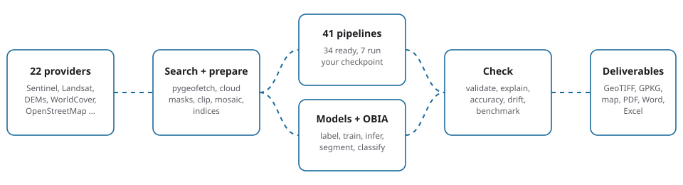

# PyGeoVision

:::{container} pgv-lead
**Geospatial AI from search to finished map.** One CLI and one Python API for finding satellite imagery, preparing it correctly,
running an analysis and delivering rasters, vectors, tables and a report.
:::

```bash
pip install "pygeovision[geo,report]"
pygeovision doctor
```

:::{container} pgv-hero

:::

::::{grid} 2 2 4 4
:gutter: 2
:class-container: pgv-stats

:::{grid-item-card} 41
:class-card: pgv-stat
:class-title: pgv-stat-n

pipelines: 34 run out of the box, 7 run your trained network
:::

:::{grid-item-card} 22
:class-card: pgv-stat
:class-title: pgv-stat-n

data providers, through pygeofetch
:::

:::{grid-item-card} 92
:class-card: pgv-stat
:class-title: pgv-stat-n

CLI commands in 25 groups, every one documented
:::

:::{grid-item-card} 79
:class-card: pgv-stat
:class-title: pgv-stat-n

buildable model architectures
:::
::::

## Overview

PyGeoVision finds satellite imagery (through [pygeofetch](https://pygeofetch.readthedocs.io/en/latest/)), prepares it
correctly, runs an analysis, and writes the deliverables. You describe the question once, as a place, a date and a
pipeline name, and PyGeoVision picks the clearest scenes, downloads only the bands the method needs, masks cloud and shadow,
computes the result and records exactly what it used. The answer comes back as a GeoTIFF you can open in a GIS, a GeoPackage
of vectors, a map, a table of figures and a PDF, Word and Excel report.

The same package contains the machinery to go further than the ready-made pipelines. You can label imagery from OpenStreetMap,
reference products and foundation models; train one of 79 architectures; run inference on a scene or a whole archive; explain
a prediction with Grad-CAM, SHAP or uncertainty maps; compare models on a leaderboard; watch a deployed model for drift; and
export to ONNX for an edge device or a cloud endpoint. For small training sets and results that must be explained object by object,
the [object-based image analysis](obia/index.md) package segments an image into objects, describes them and classifies them with
rules or a few samples.

Everything is available from Python and from the `pygeovision` command line. Repeatable work can be written as a YAML workflow and
run on a schedule. This documentation is also available in French, Spanish, Portuguese, German, Chinese and Arabic: use the globe icon in
the top bar.

:::{note}
PyGeoVision states what has and has not been verified. The [Known issues](reference/known-issues.md) page lists behaviours that differ
from what you might expect, and the less common tools carry a "Verified here?" line saying what they were run against.
:::

### A first analysis in three steps

```bash
# 1. Check the installation
pygeovision doctor

# 2. Surface water over part of London, June 2024 (no account needed)
pygeovision channel water_bodies --bbox -0.15 51.47 -0.10 51.52 --date 2024-06 --output ./first_run

# 3. Read what the run measured before you look at the map
cat first_run/run_summary.json
```

The [Quickstart](getting-started/quickstart.md) walks through the same steps with explanations and the files each one writes, and
the [examples](examples/index.md) show complete workflows by domain.

::::{grid} 1 1 2 3
:gutter: 3

:::{grid-item-card} Get started
:link: getting-started/quickstart
:link-type: doc

Install, run a first pipeline and read its result in ten minutes, with no account.
:::

:::{grid-item-card} Pick a pipeline
:link: pipelines/choosing
:link-type: doc

"I want to map X" to the pipeline that does it, with its limits.
:::

:::{grid-item-card} The 41 pipelines
:link: pipelines/catalog/index
:link-type: doc

Every pipeline on its own page: why, how, what to change, outputs and what to do when it fails.
:::

:::{grid-item-card} Find and prepare data
:link: data/index
:link-type: doc

Search, download, cloud masks, indices, radiometry, radar and reference products.
:::

:::{grid-item-card} Models by task
:link: models/tasks
:link-type: doc

Segmentation, classification, detection, change detection, LiDAR, super-resolution and vision-language, each with models, training and prediction.
:::

:::{grid-item-card} Foundation models
:link: foundation-models/index
:link-type: doc

Prithvi-EO, DOFA, DINOv3, CLIP, SAM and embeddings as starting points.
:::

:::{grid-item-card} Label data
:link: labeling/index
:link-type: doc

Labels from OpenStreetMap, reference products, SAM and foundation models, with quality checks.
:::

:::{grid-item-card} Train a model
:link: training/index
:link-type: doc

Data, configuration, losses, fine-tuning, resuming, speed and export.
:::

:::{grid-item-card} Run inference
:link: inference/index
:link-type: doc

Tiles, seams, many scenes, ensembles and the command line.
:::

:::{grid-item-card} Experiments
:link: experiments/index
:link-type: doc

Tracking, hyper-parameter search, AutoML and benchmarks.
:::

:::{grid-item-card} Object-based analysis
:link: obia/index
:link-type: doc

Segment real imagery into objects, describe them and classify with rules or a few samples.
:::

:::{grid-item-card} Explain and monitor
:link: explainability/index
:link-type: doc

Grad-CAM, SHAP and uncertainty; drift, alerts and performance watching.
:::

:::{grid-item-card} Deploy
:link: deployment/index
:link-type: doc

ONNX and Jetson at the edge; SageMaker, Azure ML and Vertex AI in the cloud.
:::

:::{grid-item-card} Case studies
:link: case-studies/index
:link-type: doc

Eight real runs, read closely: floods, a wildfire, streams, water quality and central London.
:::

:::{grid-item-card} Examples by domain
:link: examples/index
:link-type: doc

Agriculture, forestry, urban, water, disaster, mining and climate workflows.
:::

:::{grid-item-card} Command-line reference
:link: reference/cli/index
:link-type: doc

All 92 commands in 25 groups, generated from the installed package.
:::

:::{grid-item-card} Python API reference
:link: reference/python-api
:link-type: doc

Every package: the client, pipelines, models, training, inference and more, rendered from source.
:::

:::{grid-item-card} Something went wrong
:link: getting-started/troubleshooting
:link-type: doc

Symptom-first fixes, plus the [FAQ](getting-started/faq.md).
:::

:::{grid-item-card} Known issues
:link: reference/known-issues
:link-type: doc

Documented limitations and behaviours that differ from what you might expect.
:::
::::

## Who it is for

- **Analysts and researchers** who need a defensible map from open data without assembling a processing chain themselves.
- **Engineers** who run acquisition, inference and reporting unattended, on a schedule.
- **ML practitioners** who label, train, explain and monitor models on imagery.
- **Teams** that want open, scriptable Earth observation tooling with documented methods instead of a black box.

## How the documentation is organised

The sidebar has one group for each topic below, so you can see every page of a section without opening anything else.

| Section | Use it to |
|---|---|
| **Getting started** | Install PyGeoVision, run a first pipeline, understand the core concepts and diagnose problems. |
| **Data** | Find and download imagery; prepare, mask, index and validate it. |
| **Pipelines** | Choose among the 41 pipelines, read each on its own page, modify or write one, and chain them in YAML. Each topic is a group. |
| **Segmentation, Classification, Object detection, Change detection** | Models, training and prediction for each task. |
| **Foundation models, Vision-language, 3D / LiDAR, Super-resolution, Time series** | The newer tools, each with its own pages. |
| **Object-based analysis** | Segment, describe, classify and assess imagery object by object, on real scenes. |
| **Models, Labelling, Training, Inference, Experiments** | The machine-learning workflow, one group per stage. |
| **Explainability, Monitoring, Reporting, Deployment** | Trust, watch, report and ship a model. |
| **Case studies** | Read eight real reports closely: what each number means, what the run can and cannot support, and what to change. |
| **Examples** | Follow end-to-end workflows by domain. |
| **CLI reference, Python API, Reference** | Look up every command, every package, the settings, exceptions and known issues. |
| **Project** | Read the changelog and roadmap, and learn how to contribute. |

## What PyGeoVision will and will not do

- It **does** run analyses whose method is documented and whose output was checked against a known answer, and tells
  you when it cannot (no data, too much cloud, no checkpoint) instead of producing a plausible-looking map.
- It **does not** ship trained task models (crop type, solar panels, species …). It ships architectures, and fetches
  public pretrained weights where a genuine checkpoint exists. A pipeline that needs your weights says so before
  downloading any imagery.
- It **does not** give accuracy figures it has not measured. Accuracy sections of the pages tell you how to measure it
  on your own reference data ([validation](data/validation.md), [OBIA accuracy](obia/accuracy.md)).

```{toctree}
:maxdepth: 1
:caption: Getting started
:hidden:

getting-started/installation
getting-started/quickstart
getting-started/concepts
getting-started/configuration
getting-started/diagnostics
getting-started/troubleshooting
getting-started/faq
architecture
```

```{toctree}
:maxdepth: 1
:caption: Data: find and download
:hidden:

data/index
data/search-and-download
data/providers
data/authentication
data/scene-selection
data/boundaries
data/reference-data
data/footprints
datasets/index
```

```{toctree}
:maxdepth: 1
:caption: Data: prepare and check
:hidden:

data/preprocessing
data/radiometry
data/indices
data/texture
data/sar
data/ai-ready
data/postprocessing
data/validation
data/yaml-pipelines
```

```{toctree}
:maxdepth: 1
:caption: Pipelines
:hidden:

pipelines/index
pipelines/choosing
pipelines/catalog/index
pipelines/results
pipelines/yaml-workflows
pipelines/custom
pipelines/removed
```

```{include} pipelines/_sidebar.md
```

```{toctree}
:maxdepth: 1
:caption: Segmentation
:hidden:

segmentation/index
segmentation/models
segmentation/train
segmentation/predict
```

```{toctree}
:maxdepth: 1
:caption: Classification
:hidden:

classification/index
classification/models
classification/train
classification/predict
classification/few-shot
```

```{toctree}
:maxdepth: 1
:caption: Object detection
:hidden:

detection/index
detection/models
detection/train
detection/predict
```

```{toctree}
:maxdepth: 1
:caption: Change detection
:hidden:

change-detection/index
change-detection/models
change-detection/train
change-detection/predict
```

```{toctree}
:maxdepth: 1
:caption: Foundation models
:hidden:

foundation-models/index
foundation-models/models
foundation-models/prithvi
foundation-models/dofa
foundation-models/dinov3
foundation-models/clip
foundation-models/sam
foundation-models/embeddings
foundation-models/radar
```

```{toctree}
:maxdepth: 1
:caption: Vision-language
:hidden:

vision-language/index
vision-language/models
vision-language/foundation
vision-language/clip
vision-language/captions
vision-language/cli
```

```{toctree}
:maxdepth: 1
:caption: 3D / LiDAR
:hidden:

lidar/index
lidar/models
lidar/canopy-height
lidar/buildings
lidar/classify
```

```{toctree}
:maxdepth: 1
:caption: Super-resolution
:hidden:

super-resolution/index
super-resolution/models
super-resolution/run
```

```{toctree}
:maxdepth: 1
:caption: Time series
:hidden:

timeseries/index
```

```{toctree}
:maxdepth: 1
:caption: Object-based analysis (OBIA)
:hidden:

obia/index
obia/tutorial
obia/real-data
obia/segmentation
obia/scale
obia/features
obia/classification
obia/hierarchy-context
obia/accuracy
obia/data-io
```

```{toctree}
:maxdepth: 1
:caption: Models
:hidden:

models/index
models/tasks
models/choosing
models/registry
models/catalog
models/unavailable
```

```{toctree}
:maxdepth: 1
:caption: Labelling
:hidden:

labeling/index
labeling/workflow
labeling/osm
labeling/buildings
labeling/landcover
labeling/sam
labeling/foundation
labeling/naming-segments
labeling/pipeline
labeling/quality
labeling/active
labeling/tile-labelers
```

```{toctree}
:maxdepth: 1
:caption: Training
:hidden:

training/index
training/data
training/config
training/losses
training/fine-tuning
training/resuming
training/performance
training/callbacks
training/export
training/multitask
```

```{toctree}
:maxdepth: 1
:caption: Inference
:hidden:

inference/index
inference/tiles
inference/batch
inference/ensembles
inference/engine
inference/cli
```

```{toctree}
:maxdepth: 1
:caption: Experiments
:hidden:

experiments/index
experiments/tracking
experiments/search
experiments/automl
experiments/benchmark
experiments/leaderboard
```

```{toctree}
:maxdepth: 1
:caption: Explainability
:hidden:

explainability/index
explainability/gradcam
explainability/uncertainty
explainability/attention
explainability/shap
```

```{toctree}
:maxdepth: 1
:caption: Monitoring
:hidden:

monitoring/index
monitoring/drift
monitoring/performance
monitoring/alerts
monitoring/site-tracking
```

```{toctree}
:maxdepth: 1
:caption: Reporting
:hidden:

reporting/index
reporting/contents
reporting/vectors
reporting/rebuilding
```

```{toctree}
:maxdepth: 1
:caption: Deployment
:hidden:

deployment/index
deployment/edge
deployment/jetson
deployment/cloud
deployment/sagemaker
deployment/azure
deployment/vertex
```

```{toctree}
:maxdepth: 1
:caption: Case studies
:hidden:

case-studies/index
case-studies/flood-accra
case-studies/flood-nepal
case-studies/wildfire
case-studies/drainage-tyrol
case-studies/water-quality
case-studies/london-landcover-habitat
case-studies/london-buildings-roads
case-studies/london-vegetation
```

```{toctree}
:maxdepth: 1
:caption: Examples
:hidden:

examples/index
examples/agriculture
examples/forestry
examples/urban
examples/water
examples/disaster
examples/mining
examples/climate
```

```{include} reference/cli/_sidebar.md
```

```{include} reference/api/_sidebar.md
```

```{toctree}
:maxdepth: 1
:caption: Reference
:hidden:

reference/config
reference/exceptions
reference/security
reference/known-issues
reference/testing
reference/glossary
```

```{toctree}
:maxdepth: 1
:caption: Project
:hidden:

project/changelog
project/roadmap
project/contributing
```
