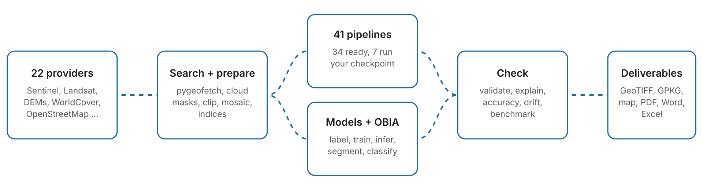

<!--
AUTHOR NOTES (invisible in the output; delete before submission).
Everything below the front matter was checked against the repository and the eight
case-study pages. Claims from the previous draft that the repository does not support
were removed; they are preserved, with the reason, in the comment block at the end of
the file, so you can reinstate any that you can back with data. See REVISION_NOTES.md.
-->

# Summary

`pygeovision` is an open-source Python library and command-line tool that takes a user from
a bounding box and a date to a *checked* geospatial result. It searches and downloads imagery
from 22 providers through `pygeofetch` [@appiahkubi2025pygeofetch], selects and joins the
clearest scenes, and runs one of 41 documented analysis pipelines (34 run without any trained
weights; 7 run a network the user trains). Every run writes rasters, vector layers, PDF, Word
and Excel reports, and a machine-readable record of all settings, inputs and statistics.
Underneath the pipelines the same parts are available separately: preprocessing and 21
spectral indices, label generation, training and tiled inference for 79 model architectures,
embeddings from foundation models such as Prithvi-EO [@jakubik2023prithvi; @szwarcman2024prithvi]
and DINOv2 [@oquab2023dinov2], explainability, and object-based image analysis (OBIA)
[@blaschke2010obia; @blaschke2014geobia].

`pygeovision` is designed for institutions that need reproducible Earth observation (EO)
products but cannot depend on a proprietary cloud account or assemble a data, preprocessing and
deep-learning stack themselves. It runs on a laptop, uses only open data by default, does not
ship trained task models, and states in every report what share of the study area was actually
observed.

# Statement of need

Free Sentinel-1 radar and Sentinel-2 optical imagery cover the whole Earth every few days
[@torres2012sentinel1; @drusch2012sentinel2], yet turning scenes into a trustworthy answer
remains slow. Digital Earth Africa describes the problem plainly: preprocessing is repeated by
each user, "consuming weeks or months of resources" [@digitalearthafrica]. Three further gaps
motivate this software.

1. **Questions, not tools.** Most open packages supply building blocks (loaders, models,
   cloud back ends). A practitioner who asks "where is the newly flooded ground, and how many
   independent sensors agree?" still has to design the method, choose thresholds, handle cloud,
   and decide what to report. `pygeovision` packages those decisions as named pipelines, each
   with a documented method, its arguments, its limitations and a stated failure behaviour.
2. **Results that say how far to trust them.** A map without its valid-pixel share, the
   scenes it used and the settings behind it cannot be audited or reproduced. Every
   `pygeovision` run records these, separates "no data" from every class, and reports shares
   both of the valid pixels and of the whole box.
3. **Evidence that foundation models are not a universal answer.** Recent benchmarks find that
   geospatial foundation models "do not consistently outperform supervised models"
   [@marsocci2024pangaea], and earlier landslide work found that convolutional networks "do not
   automatically outperform" classical learners [@ghorbanzadeh2019landslide]. A platform for
   operational use should therefore offer documented classical methods, OBIA and user-trained
   networks next to foundation models, and say plainly which is which.

The intended users are government analysts (disaster management, environmental protection,
forestry), academic researchers in data-sparse regions, and programme staff in non-governmental
organisations who need satellite-derived evidence that can be reproduced and defended.

A complete flood-mapping analysis, from search to polygons and a report, is one call. This is
the call that produced the Accra case study below:

```python
from pygeovision import PyGeoVision

client = PyGeoVision()
result = client.pipeline(
    "multisensor_flood_mapping",
    bbox=(-0.35, 5.45, 0.05, 5.75),                 # west, south, east, north
    date_before="2026-06-01/2026-06-20",            # dry reference window
    date_after="2026-06-27/2026-07-06",             # flood window
    output_dir="out/accra",
)
if not result.success:
    raise SystemExit(result.error)                   # a specific reason, never empty
print(result.stats["flooded_area_ha"], result.stats["excluded_by_hand_ha"])
```

The equivalent command is `pygeovision channel multisensor_flood_mapping --bbox -0.35 5.45 0.05
5.75 --date-before 2026-06-01/2026-06-20 --date-after 2026-06-27/2026-07-06 --output out/accra`.

# Installation and availability

`pygeovision` requires Python 3.10 or later and is installed with `pip install pygeovision`.
Optional extras add training, foundation models and the full stack. The source code, issue
tracker and documentation are at <https://github.com/EOCoreINT/pygeovision>. The software is
released under the MIT licence.

# State of the field

## Existing tools

Table 1 lists the tools a reader is most likely to compare with. The second column is what each
project's own documentation presents as its main job; the last column says how `pygeovision`
relates. A dash means "not found in the documentation we read", not "impossible". The
documentation was read in October 2026 and these projects change quickly.

| Tool | Main job, as documented | What it needs | Relation to `pygeovision` |
|:-------------|:-----------------------------|:-------------------|:----------------------------------|
| Google Earth Engine [@gorelick2017gee] with `geemap` [@wu2020geemap] | Planetary-scale analysis on Google's infrastructure | An account; processing runs on remote servers | `pygeovision` runs locally and writes a full run record, at the price of no planetary-scale processing |
| openEO [@schramm2021openeo] | One API over several cloud back ends, built on virtual data cubes; Python, R and JavaScript clients | A back end that implements it | `pygeovision` does not abstract over back ends. It offers ready analyses rather than a way to compose them |
| Open Data Cube [@lewis2017datacube] and Digital Earth Africa [@digitalearthafrica] | An indexed archive of analysis-ready data; Digital Earth Africa serves it for the continent, including a service for more than 700,000 water bodies | An index and storage to self-host, or use of the hosted service | Complementary. A cube is the right tool for continental time series; `pygeovision` is for a team that needs one answer for its own area and cannot host an archive |
| `sits` [@simoes2021sits] | R package for classifying satellite image time series on data cubes, with machine learning, smoothing, area estimation and accuracy assessment | R | Similar goals in a different language. `sits` is built around time-series classification; `pygeovision` offers ready, named pipelines for other questions and automatic reports |
| `eo-learn` [@sentinelhub2021eolearn] | EOPatch, task and workflow objects for EO machine learning; its input tasks obtain data from Sentinel Hub services | Sentinel Hub for those tasks | `pygeovision` searches open catalogues directly and hides the workflow objects behind pipelines |
| `TorchGeo` [@stewart2022torchgeo] | Datasets, samplers, transforms and pretrained models for PyTorch | — (a library) | Different layer. `TorchGeo` is for research code; scene search and selection are not its focus |
| `TerraTorch` [@gomes2025terratorch] | Fine-tuning toolkit for geospatial foundation models, with data modules and GEO-Bench support [@lacoste2023geobench] | — (a library) | `TerraTorch` is the better tool for foundation-model research. `pygeovision` wraps embeddings and leaves fine-tuning of foundation models outside its core |
| `GeoAI` [@wu2026geoai], `leafmap` [@wu2021leafmap], `samgeo` [@wu2023samgeo] | Python tools for AI on geospatial data and interactive mapping. `GeoAI` searches and downloads Sentinel, Landsat and NAIP imagery, offers segmentation, detection and classification, and catalogues 20 foundation models | — | The closest in spirit. In the documentation we read, SAR appears only as a model-filter tag and reports are not mentioned; `pygeovision` adds scene selection, named question-level pipelines, reports and a run record |
| `pyroSAR` [@truckenbrodt2019pyrosar] | Large-scale SAR (Sentinel-1) processing, with interfaces to SNAP and GAMMA | SNAP and GAMMA interfaces, per its API sections | SAR only; `pygeovision` takes radar from catalogues that serve terrain-corrected products (for example Sentinel-1 RTC from Planetary Computer) and gets InSAR through `pygeofetch` |
| `pygeovision` | From bounding box and date to a checked result: search, prepare, analyse, report | Python; the default open-data pipelines need no account | |

: Comparison with existing tools.

Three observations follow. First, the large platforms (Earth Engine, openEO, the Open Data
Cube) solve *scale* and are the right choice when the area is a continent or the series is
decades long; `pygeovision` does not compete there. Second, the PyTorch libraries solve
*model research* and are the right choice for benchmarking networks; `pygeovision` is not a
research framework for new architectures. Third, the gap `pygeovision` targets is between the
two: a locally installed, open, auditable layer that turns a question about one area into a
documented method, a result and a report. Integration of data access
with models is therefore no longer unique to `pygeovision`: tools such as `GeoAI` now search,
download and preprocess imagery. What remains distinctive is the combination of named
pipelines with documented limits, scene selection that reports coverage, and the per-run record
(Table 2).

| Capability | What `pygeovision` does | Where it is documented |
|:--------------------|:--------------------------------------|:--------------------|
| Scene selection | Picks the fewest, clearest scenes that cover the box (at most four, plus up to four more to close gaps) and joins them; reports the share of the box covered per image | Scene selection and `run_summary.json` |
| No data is never a class | Class rasters use 255 and continuous rasters use NaN, written into the file's no-data tag; cloud is "unknown", never "dry" | Reading results |
| Two denominators | Shares are given of the valid pixels and of the whole box, and the two are labelled | Reading results |
| Run record | `run_summary.json` holds version, time, box, dates, every parameter (defaults included), scene identifiers, per-image coverage, statistics and per-class areas | Reading results |
| Fail loudly | A run that cannot do its job correctly returns `success=False` with a specific error and writes no summary, rather than a poor-looking map | Reading results |
| Honest weights policy | No trained task models are shipped. Seven pipelines run a network the user trained and stop with a clear message without `--checkpoint` | Pipeline catalogue |

: Design features that distinguish `pygeovision` from the tools in Table 1.

## Object-based and deep-learning methods

Object-based image analysis (GEOBIA) established segmentation into image objects, object-level
features and object-level accuracy as a distinct paradigm for high-resolution imagery
[@blaschke2010obia; @blaschke2014geobia]. `pygeovision` includes an OBIA module with
scale-controlled segmentation, object features, rule-based, fuzzy and supervised
classification, and object-level accuracy, next to its deep-learning stack. This follows the
evidence that neither family dominates: in a landslide study, the best convolutional network
reached 78.26 % mean intersection over union with spectral information only, and the authors
concluded that networks do not automatically beat classical learners
[@ghorbanzadeh2019landslide]. Benchmarks for landslide detection [@ghorbanzadeh2022landslide4sense]
and for geospatial foundation models [@lacoste2023geobench; @marsocci2024pangaea] are the
natural places to test `pygeovision` models in the future (see the evaluation plan below).

# Software design

`pygeovision` has five layers that can be used independently, and a command-line interface and
Python API that cover the same ground (25 command groups, 92 commands).

{width=100%}

**Data layer.** `pygeofetch` [@appiahkubi2025pygeofetch] gives one search and download
interface across 22 providers, including Copernicus Data Space and Microsoft Planetary
Computer, and STAC catalogues [@stac2021]. Downloads are resumable and verified, and results
are cached. `pygeovision` adds scene selection and mosaicking, and reads and writes rasters and
vectors with `rasterio` [@gillies2019rasterio] and `geopandas` [@jordahl2020geopandas].

**Preparation layer.** Cloud, shadow and cirrus are masked per pixel with the Sentinel-2 Scene
Classification Layer, so that a mostly cloudy scene still contributes its clear pixels.
Preprocessing includes clipping, resampling, radiometric steps, 21 spectral indices and
transforms, and AI-ready preparation of tiles.

**Pipeline layer.** The 41 pipelines each carry a documented method, a table of arguments,
a "what you get" table of files and classes, a list of limitations, and the situations in which
not to use them. The methods are published ones: for example, water from the normalised
difference water index [@mcfeeters1996ndwi] or its modified form [@xu2006mndwi], vegetation
change from NDVI differencing [@tucker1979ndvi], burn severity from dNBR classes
[@key2006firemon], and streams and height above the nearest drainage (HAND) [@nobre2011hand]
from a depression-filled elevation model [@barnes2014priorityflood] with D8 routing
[@ocallaghan1984d8]. Pipelines can also be written as YAML workflows and scheduled.

**Model layer.** The registry has 79 buildable architectures for segmentation, detection,
classification and change detection (for example ChangeFormer [@bandara2022changeformer]),
a trainer with geospatial losses and mixed precision, tiled inference for full scenes, ONNX
export, and Grad-CAM-style explainability. Foundation-model wrappers provide embeddings from
Prithvi-EO, DINOv2, SAM, CLIP and RemoteCLIP, DOFA, TESSERA and AlphaEarth. Training uses
`PyTorch` [@paszke2019pytorch] and classical learners use `scikit-learn`
[@pedregosa2011sklearn]; arrays are handled with `NumPy` [@harris2020numpy].

**Reporting layer.** Each run writes georeferenced rasters, a GeoPackage and GeoJSON of the
classes (area, share and colour per polygon), PNG maps, and PDF, Word and Excel reports, from
the same specification, so that the report and the files cannot disagree. A finished run can be
re-reported without downloading again.

SAR processing and InSAR are provided by `pygeofetch`; `pygeovision` consumes terrain-corrected
Sentinel-1 products and does not re-implement the interferometric chain.

## Testing

The repository's test suite collects 2,285 tests (release 2.1.8, counted with
`pytest --collect-only`). It runs the real pipelines on synthetic scenes with known answers,
with downloads patched, and checks that documentation commands and Python examples are valid
and ask for the same thing. **No test runs against live imagery, a GPU or a downloaded
pretrained checkpoint**; Section "Limitations" lists what this leaves unverified.

# Case studies compared with published work

## What the case studies are

Eight documented studies were built from real runs of nine pipelines at six places: two flood
maps (Accra coast and central Nepal), burn severity (northern California), streams and HAND
(Tyrol), water-quality indicators (upper Chesapeake Bay), and three studies of one central
London box (land cover and habitat, buildings and roads, and vegetation change). Each study
takes one PDF report that `pygeovision` wrote, copies its numbers into a data file, recomputes
the arithmetic between them in the test suite, reproduces the mechanism behind any oddity on
the real pipeline with a small synthetic input whose answer is known, and says what the report
can and cannot support.

**These are not accuracy assessments.** No case study had reference data. Nothing was re-run
for the documentation, and no figure was recomputed from imagery. What the studies test is the
*reporting*: whether the output exposes its own limits. Figure 2 shows four of the report maps.

{width=100%}

## Comparison with published studies

Table 3 sets each study beside comparable published work. The comparison is of *method,
validation practice and reporting*, because the numbers are not comparable: the events, areas,
dates and sensors differ, and the published studies were validated while ours were not.

| Case study and pipeline | What `pygeovision` reported | Comparable published work | The difference that matters |
|:-----------------|:--------------------------|:-------------------------|:-----------------------------|
| Flood, Accra coast, `multisensor_flood_mapping` | 81.4 ha flooded (upper bound 84.8 ha) of 89,441 ha of land (0.1 %); only 4.2 ha seen by both radar and optical; optical was clear over 18.1 % of the box; terrain filter removed 9.0 ha; radar threshold calibrated to −13.8 dB | A fully automated Sentinel-1 chain at two sites on the Greece–Turkey border: overall accuracy 94.0 to 96.1 %, kappa 0.879 to 0.910 [@twele2016flood]. National-scale Sentinel-1 backscatter-ratio mapping for Ghana, whose abstract notes that most earlier flood work focused on Accra and that in-situ validation is limited [@toffah2026ghana] | Two of the published studies report accuracy against reference maps and the Ghana study acknowledges limited in-situ validation. `pygeovision` reports a range, keeps radar and optical evidence apart as classes (confirmed, radar only, optical only, disputed), and says how much of the map rests on one sensor. It reports no accuracy |
| Flood, central Nepal, `multisensor_flood_mapping` | 451.7 ha flooded, 90 % of it "optical only", 3 % confirmed by both; the terrain filter did not run because the grid had 13.5 million cells against a limit of 6 million | A Bangladesh 2017 case study with Sentinel-1 and a knowledge-based classification, validated against a Landsat-8 object-based flood map: overall accuracy 96.44 % [@uddin2019bangladesh] | The report states which processing stage was skipped, and the documentation gives the one argument (`resolution_m=30`) that would restore it. The rerun has not been tried |
| Burn severity, northern California, `wildfire_severity` | 49,568.1 ha (15.6 % of valid area) in a 3,321 km² box, with a mean dNBR of −0.023; the report names no fire | The Monitoring Trends in Burn Severity project maps severity from Landsat dNBR for fires above 404 ha in the west [@eidenshink2007mtbs], with classes after @key2006firemon. `pygeovision` uses the same simplified class limits (0.10, 0.27, 0.66) | MTBS maps severity fire by fire, inside a perimeter. Run over a box with no perimeter, the output is "numerically clean" but is not a burn scar; the study shows why a perimeter, or a named event, is needed before the figure is quoted |
| Streams and HAND, Tyrol, `drainage_analysis` | 64.8 km of streams, density 0.72 km per km², 19.5 % of ground within 15 m of a stream, mean HAND 220.1 m; 5.8 % of cells raised by depression filling, up to 30.3 m | HAND was introduced and validated over 18,000 km² of the Rio Negro catchment [@nobre2011hand]; terrain tools such as Whitebox provide comparable hydrological preprocessing [@lindsay2016whitebox] | The published validation is for a lowland catchment; in steep alpine ground a 30 m fill in a 30 m model is, we suggest, more likely a surface-model artefact than a lake (a hypothesis not tested here). The report prints the fill so the reader can see it. No comparison with another tool's streams was made |
| Water quality, upper Chesapeake Bay, `water_quality` | Mean NDCI 0.249 inside 2.1 % of the box that is water; the valid share was 40.7 %; 48 % of the water pixels have no NDCI because the ratio is undefined | NDCI was proposed for chlorophyll-a in turbid productive waters [@mishra2012ndci]. Calibrated NIR-red algorithms report concentrations with errors (a mean absolute error of 4.32 mg m⁻³ over about 1 to 108 mg m⁻³ in the Azov Sea) [@moses2012chl] | Published algorithms are calibrated to in-situ chlorophyll. `pygeovision` gives only a *relative* indicator in terciles, and leaves undefined pixels empty rather than inventing a value. It claims no concentration |
| Land cover and habitat, central London, `land_cover`, `biodiversity_hotspot` | 73.8 % built-up; a "hotspot" share of exactly 10.0 % | The map is ESA WorldCover [@zanaga2022worldcover]; a time-specific alternative is Dynamic World [@brown2022dynamicworld] | The 10 % is the percentile the user chose, true by construction, and the study says so. The default source describes 2021 whatever date is passed, and the report states that |
| Buildings and roads, central London, `building_footprints`, `road_network` | 5,898 buildings (33.5 % footprint coverage); 1,030 km of roads, of which 599 km are tracks and paths | Open building datasets include a continental one for Africa with 516 million footprints [@sirko2021openbuildings]; OpenStreetMap roads were judged more than 80 % complete globally [@barringtonleigh2017roads] | These are datasets, not detections: the totals reflect the source's completeness and date. The density rasters hold less than the headline figures, and the page shows where the difference goes |
| Vegetation change, central London, `crop_health` | 5.8 % of the valid area flagged for an NDVI drop above 0.20, but the valid share was 44.2 % and the two dates were three months apart | NDVI differencing is a long-standing change-detection technique [@tucker1979ndvi; @lu2004change] | A crop-health pipeline pointed at a city measures season and cloud, not stress. The 5.8 % is a share of the valid area, 2.6 % of the box |

: Case studies beside comparable published work.

## What the comparison shows

Three points follow, and each is limited by what was and was not done.

**Reporting practice differs in a complementary way.** Two of the published flood studies above
report accuracy against reference maps [@twele2016flood; @uddin2019bangladesh]. The
`pygeovision` reports do not, because the case studies had no reference data. In exchange, every
`pygeovision` report states the valid share (18.1 % optical clear in Accra, 19.8 % in Nepal,
44.2 % in the London vegetation run), the settings actually used, the scenes, and what was
skipped. The two kinds of reporting answer different questions, and an operational product needs
both. The numbers that look like accuracy in a `pygeovision` report are not: the F1 of 0.99 in
the Accra report measures agreement between radar and optical water in the dry window, which is
how the radar threshold was calibrated, not agreement with the truth.

**Several case studies are informative because the run went wrong.** The Nepal study (terrain
filter skipped), the water-quality study (nearly half of the water without an indicator), and
the London vegetation study (a crop pipeline on a city) end on "do not quote this number yet".
We regard the ability of the output to make that visible as the main result of this section.
It does not show that the pipelines are accurate.

**What cannot be claimed.** The case studies do not show that `pygeovision` is more accurate,
faster or easier than the tools in Table 1. No timing or accuracy comparison against another
tool was made. The sentence "a complete analysis is one call" is a statement about the interface,
not about quality.

# Evaluation plan

The honest next step is quantitative. Table 4 lists comparisons that would turn the case
studies into accuracy results, using public reference data. None has been run.

| Question | Reference data | What would be measured | Related published work |
|:-------------------|:---------------------------|:----------------------------|:------------------------|
| Flood extent from radar and optical | Hand-labelled flood chips of Sen1Floods11 (11 events, 446 hand-labelled chips) [@bonafilia2020sen1floods11] | Overall accuracy, IoU and kappa of `multisensor_flood_mapping` against the hand labels, with and without the optical and terrain stages | @twele2016flood; @uddin2019bangladesh |
| Burn severity | Burned-area perimeters and severity classes from the MTBS project [@eidenshink2007mtbs] for a named fire | Agreement of the dNBR classes inside and outside the perimeter | @key2006firemon |
| Deep-learning and OBIA detection | Landslide4Sense, 3,799 patches from four regions [@ghorbanzadeh2022landslide4sense] | mIoU of `pygeovision` U-Net-type models and of the OBIA module, trained and tested on the same split | @ghorbanzadeh2019landslide |
| Foundation-model embeddings | GEO-Bench and PANGAEA tasks [@lacoste2023geobench; @marsocci2024pangaea] | Whether the wrappers reproduce published scores for the same checkpoints | @szwarcman2024prithvi |
| Water-quality indicator | In-situ chlorophyll-a for the same dates | Correlation of NDCI with measured chlorophyll, and a calibrated mapping | @mishra2012ndci; @moses2012chl |
| Terrain hydrology | Streams from another tool (for example Whitebox) on the same elevation model | Stream-cell agreement and HAND differences | @lindsay2016whitebox; @nobre2011hand |
| Cost and effort | The same flood question in Earth Engine or `GeoAI` | Lines of code, run time and the information each output carries | @gorelick2017gee; @wu2026geoai |

: Planned quantitative comparisons.

# Limitations

`pygeovision` does not ship trained task models, and seven pipelines need a checkpoint the user
trained. It does not download datasets automatically: its catalogue of 460 datasets is
metadata. Outputs of real DINOv2, CLIP, RemoteCLIP, Moondream, DOFA, Prithvi and SAM weights, of
Ray Tune, MLflow, mixed precision, distributed training, TensorRT and the live cloud paths, and
the classification accuracy of LiDAR models, are **not verified here**, because the test
environment had no network and no GPU. No pipeline has been validated on real imagery with
ground truth. Urban flooding is under-mapped by both radar and optical imagery, and the flood
pipeline cannot see water that receded before the satellite passed. The `gpu` and `training`
sections of the configuration file are stored but not read. These items and others are tracked
in the project's roadmap and known-issues pages.

# Research impact statement

The documented evidence of use consists of the eight case studies above, which exercise nine of
the 41 pipelines on real Sentinel, elevation and published map data over six places, on four
continents, and which uncovered concrete limitations (a skipped
terrain stage, an undefined index, a share that is true by construction) that are now stated in
the documentation and covered by tests. The platform underpins EOCoreINT, a structured learning
programme delivering 20 courses in Earth observation and geospatial AI to researchers and
government analysts across Africa.

# AI usage disclosure

Large language model assistance (Claude, Anthropic) was used in developing `pygeovision` for
boilerplate code, docstrings and test scenarios, and in the documentation, including the case
studies. For this manuscript, Claude was used to check the draft against the repository, to
search for and verify references, and to draft and restructure the comparison sections. No AI
tool generated scientific results: the figures and numbers in the case studies come from the
reports that `pygeovision` wrote for the author's runs. The author takes responsibility for the
content.

# Acknowledgements

Satellite data were provided free of charge through the European Space Agency Copernicus
programme and the NASA and USGS Landsat programme. The Prithvi-EO model weights were made
available by IBM Research and NASA [@jakubik2023prithvi; @szwarcman2024prithvi], and the DINOv2
weights by Meta AI [@oquab2023dinov2].

# References

<!--
REMOVED OR CHANGED CLAIMS FROM THE PREVIOUS DRAFT (reinstate only with evidence).

1. "A natural-language query interface (GeoAgent)" and the section "GeoAgent", with "86 % task
   routing accuracy on 150 queries" and "96 % with an LLM". Removed: pygeovision.agent was deleted
   from the package (see the roadmap) and the numbers are not reproducible from the repository.
2. "InSAR layer (pygeovision.insar)", the 170 degree / 350 degree heading discussion, and
   "2.0 cm mean absolute error against GPS CORS for the 2023 Kahramanmaras earthquake". Removed:
   the repository has no pygeovision.insar module (InSAR comes from pygeofetch), the heading
   claim is not in the code, and no GPS comparison is in the repository. If this result is
   yours, it belongs in the pygeofetch paper, with the data and script that produced it.
3. "847 hectares of inundation ... within 18 hours ... Odaw River Basin, June 2024 flood" and
   "234.7 hectares of forest cleared in Atewa Range between 2020 and 2024 (ChangeFormer)".
   Removed: not in the repository or the case studies, and ChangeFormer needs your own trained
   checkpoint. If you have the reports, add them as case studies with the same checks as the
   other eight.
4. "944+ tests ... GitHub Actions on Linux, macOS and Windows with an enforced coverage gate".
   Replaced by 2,285 collected tests (release 2.1.8). The CI statement is not visible in the
   uploaded repository (no .github folder); add it back if your workflow files exist.
5. "Apache 2.0": the repository's licence is MIT (pyproject.toml and LICENSE).
6. "25 runnable Jupyter notebooks": not found in the uploaded repository.
7. "12 spectral indices": the README says 21.
8. "SHA-256 checksum verification ... evidence in legal proceedings": softened; the first is
   in pygeofetch, the second is not something the software can promise.
9. "Prithvi-EO-2.0 with five task heads" and "DINOv2 with six task heads incl. CHMv2 canopy
   height calibrated against GEDI": not found in the repository as stated.
10. "FocalDice loss", "FastAPI REST deployment": no match in the code.
11. Acknowledgement of the Ghana EPA GIS Unit and NADMO for "operational testing": kept out
    until you confirm they agree to be named.
12. The sample code (fetch_and_preprocess, infer, export) uses methods that do not exist in the
    client. Replaced by the tested pipeline call used in the Accra case study.
13. The previous Figure 1 (Odaw flood map and InSAR displacement map) was not used, because the
    results it shows are not documented in the repository.
-->
